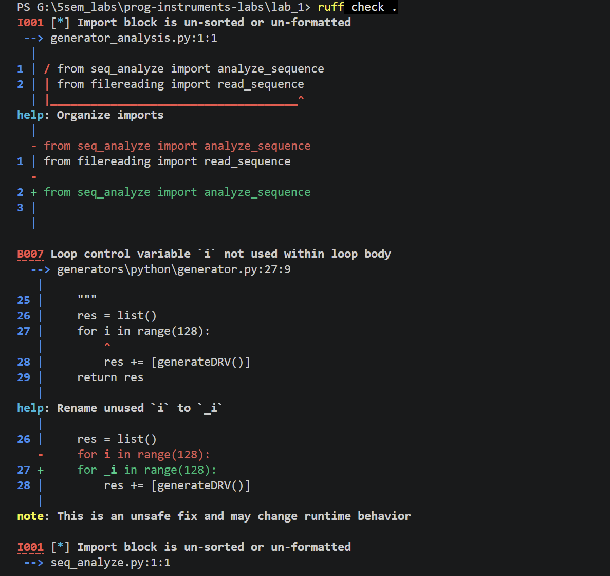
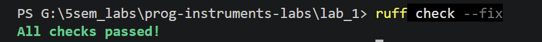
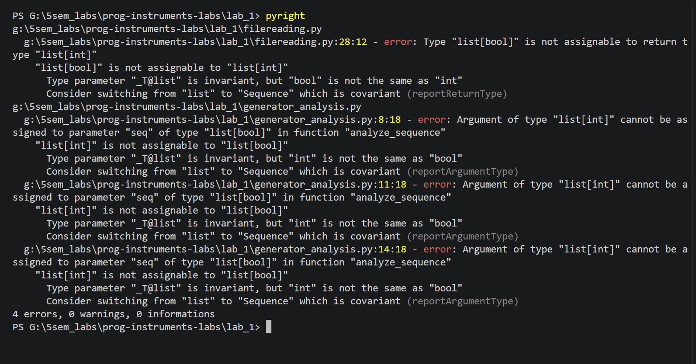
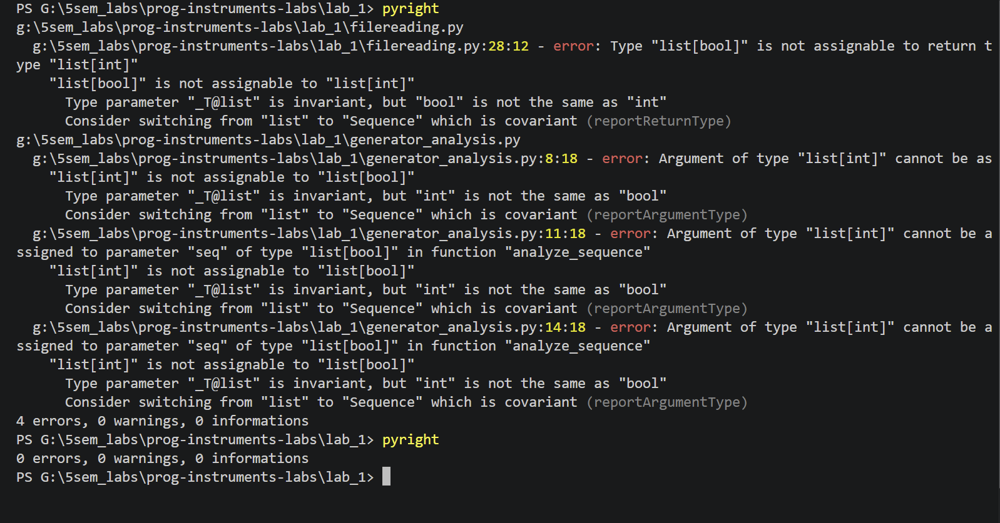
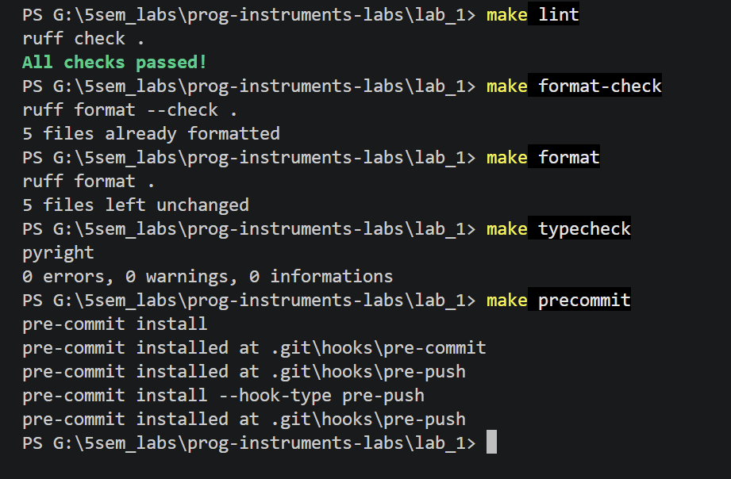
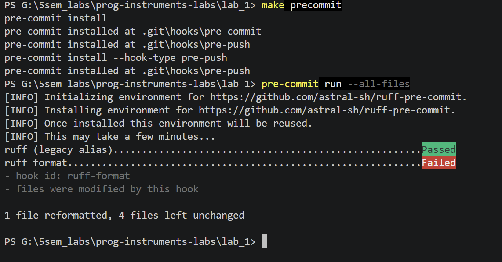
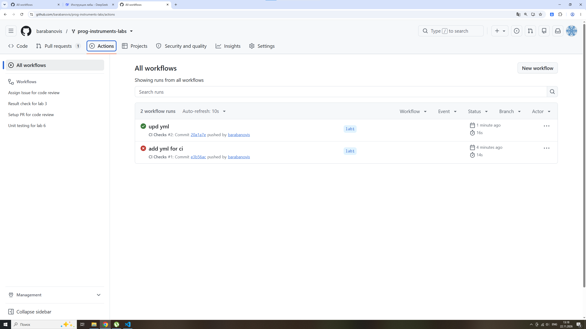

# Лабораторная работа №1: «Инструменты контроля качества и CI»

**Выполнил:**
студент Самарского университета
группы 6312-100503D, подгруппа 1
Барабанов Иван Сергеевич

---

В данной работе настроены инструменты автоматического контроля качества кода, автоматизированы типовые операции и внедрены Git-хуки и CI.

## 📂 Структура проекта и конфигурации

В рамках лабораторной работы были добавлены/изменены следующие файлы конфигурации:

- `ruff.toml` — настройки линтера и форматтера Ruff.
- `pyrightconfig.json` — настройки статического анализатора типов Pyright.
- `Makefile` — шорткаты для запуска проверок.
- `.pre-commit-config.yaml` — настройки Git-хуков (pre-commit и pre-push).
- `.github/workflows/ci.yml` — конфигурация GitHub Actions для проверки Pull Requests.

## 🛠 Настройка и исправление ошибок

### 1. Линтер и форматтер Ruff

Ruff настроен на проверку импортов, поиск неиспользуемых переменных и базовых ошибок. В ходе работы все замечания были исправлены автоматически и вручную.

**Исправление ошибок линтера:**
На скриншотах ниже показан процесс исправления ошибок с помощью `ruff check --fix`. Были исправлены несортированные импорты (I001) и неиспользуемые переменные цикла (B007).

_Скриншот: Успешное исправление ошибок и проверка форматирования._

### 2. Статическая проверка типов (Pyright)

В файлах `filereading.py` и `generator_analysis.py` изначально были ошибки несовместимости типов (например, передача `list[int]` туда, где ожидается `list[bool]` из-за инвариантности списков). Все ошибки были устранены.

**Проверка типов:**

_Скриншот: Ошибки типов до исправления (4 errors)._

_Скриншот: Успешная проверка после исправления (0 errors, 0 warnings)._

## 🚀 Makefile: автоматизация команд

Создан `Makefile`, содержащий удобные команды для разработки. Проверка всех инструментов через `make` показывает отсутствие ошибок.

**Демонстрация работы Makefile:**

_Скриншот: Успешное выполнение `make lint`, `make format-check`, `make typecheck` и установка хуков через `make precommit`._

## 🪝 Git Hooks (pre-commit)

Настроены хуки, которые запускаются перед коммитом (линтер и форматтер) и перед пушем (проверка типов и тесты).

**Установка и работа хуков:**

_Скриншот: Установка хуков. Обратите внимание, что при первом запуске `ruff-format` изменил файлы (Failed), что является нормальным поведением — хук предотвратил коммит неотформатированного кода._

## ⚙️ GitHub Actions (Дополнительное задание)

Настроен workflow для автоматической проверки Pull Requests. При создании PR запускаются джобы по проверке линтером, форматтером, типами и тестами.

Обратите внимание на скриншот!

_Скриншот: Успешное прохождение проверок в GitHub Actions (зеленые галочки)._

---

**Ссылка на исходный проект:** [Укажите ссылку на репозиторий, откуда был взят код, если применимо]
