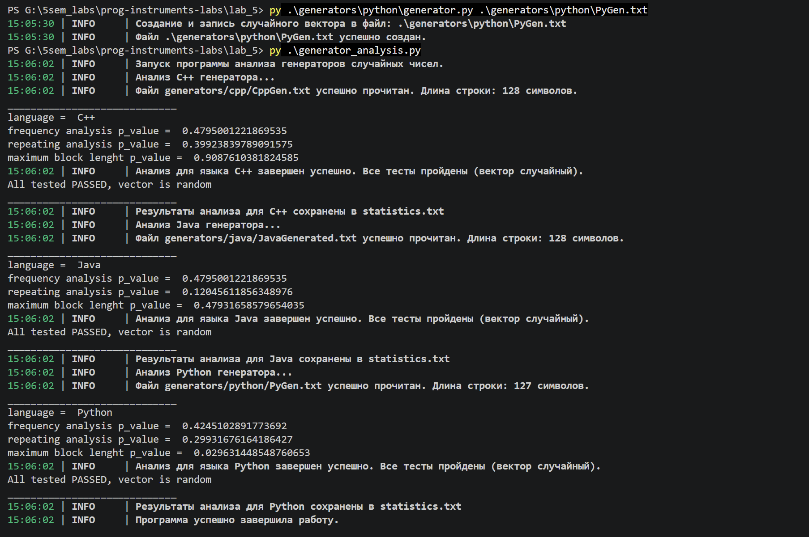

# Лабораторная работа №5 «Логирование»

**Выполнил:**
студент Самарского университета
группы 6312-100503D, подгруппа 1
Барабанов Иван Сергеевич

---

В рамках данной работы в существующий проект на Python (анализ последовательностей случайных чисел) было внедрено структурированное логирование с использованием библиотеки `loguru`.

## 📂 Что было изменено

В проекте изначально отсутствовало логирование (использовался только `print` для вывода итоговой статистики). В ходе работы были изменены следующие файлы:

- `filereading.py` — добавлено логирование процесса чтения файлов и обработки ошибок формата.
- `seq_analyze.py` — добавлено логирование результатов статистических тестов.
- `generator_analysis.py` — добавлено логирование оркестрации процесса анализа.
- `generator.py` — добавлено логирование процесса генерации случайных данных.

## 🛠 Настройка логирования

Согласно лекционному материалу, логирование настроено с соблюдением следующих принципов:

1.  **Использование библиотеки**: Вместо `print` используется `loguru`, что позволяет гибко настраивать форматы и уровни важности.
2.  **Уровни важности (Severity Levels)**: Используются `DEBUG` (для отладки), `INFO` (успешные операции), `WARNING` (тесты не пройдены), `ERROR` (ошибки чтения/формата) и `CRITICAL` (аварийное завершение программы).
3.  **Контекст**: В сообщения добавлены имена файлов, названия языков программирования, длины векторов и конкретные символы, вызвавшие ошибку.
4.  **Ротация логов**: Настроена запись не только в консоль, но и в файлы (`logs/app.log`, `logs/generator.log`) с автоматической ротацией при достижении размера в 5-10 МБ и хранением в течение 7 дней.

### Реализованные точки логирования (более 5):

1.  `DEBUG`: Старт чтения конкретного файла (с указанием пути).
2.  `INFO`: Успешное чтение файла и длина полученной строки.
3.  `ERROR`: Ошибка формата (неизвестный символ в строке) или отсутствие файла.
4.  `INFO`/`WARNING`: Результат прохождения статистических тестов (вектор случайный или нет).
5.  `INFO`: Успешное сохранение статистики в файл `statistics.txt`.
6.  `CRITICAL`: Критическая ошибка, прерывающая работу всей программы.
7.  `DEBUG`: Запуск генерации нового случайного вектора в `generator.py`.

## 📸 Демонстрация работы

На скриншоте ниже показан пример работы программы. В консоль выводятся цветные логи с метками времени, уровнями важности и контекстом (какой язык обрабатывается, какой файл читается). Также программа успешно отрабатывает и записывает результаты.


_Скриншот: Успешный запуск программы с выводом структурированных логов в консоль._

## 🚀 Запуск проекта

Для запуска проекта необходимо установить зависимости и запустить главный скрипт:

```bash
# Установка библиотеки логирования
pip install loguru

# Запуск анализа
python generator_analysis.py
```
