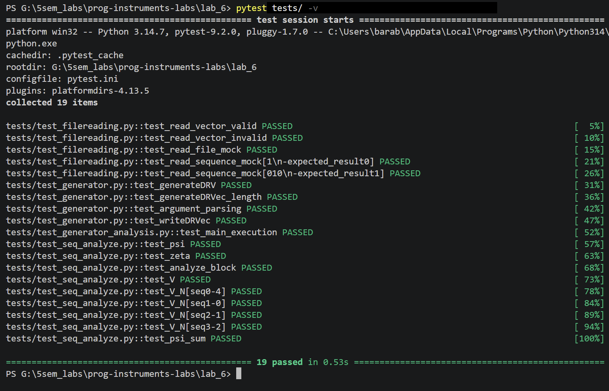

# Лабораторная работа №6 «Unit tests»

**Выполнил:**
студент Самарского университета
группы 6312-100503D, подгруппа 1
Барабанов Иван Сергеевич

---

В рамках данной лабораторной работы исходный код проекта по анализу последовательностей случайных чисел был покрыт модульными тестами с использованием фреймворка `pytest`.

## 📂 Структура проекта

Тесты находятся в директории `tests/`. Для корректного поиска модулей (test discovery) в корне проекта создан файл конфигурации `pytest.ini`.

Структура тестов:

- `tests/test_filereading.py` — тесты для чтения файлов и парсинга векторов.
- `tests/test_seq_analyze.py` — тесты для статистических и математических вычислений.
- `tests/test_generator.py` — тесты для генератора случайных чисел и парсинга аргументов.
- `tests/test_generator_analysis.py` — интеграционный тест главного скрипта.

## 🛠 Реализация тестов

В ходе работы было написано **19 тестов**, что превышает минимальное требование в 7 штук. При написании тестов соблюдались принципы, описанные в лекции.

### Продвинутые техники тестирования:

Согласно заданию, как минимум 2 теста должны быть сложнее обычных ассертов. В работе использованы следующие подходы:

1. **Параметризация (`@pytest.mark.parametrize`)**:
   Применена в тестах `test_V_N` (в `test_seq_analyze.py`) и `test_read_sequence_mock` (в `test_filereading.py`). Это позволяет проверять функцию на массиве различных входных данных (нормальное поведение, граничные условия, разные длины) без дублирования кода.
2. **Использование моков (Mocks) и патчей (`@patch`)**:
   Для изоляции тестов от файловой системы использованы `unittest.mock.mock_open` и `unittest.mock.patch`. Это позволило протестировать функции записи (`writeDRVec`) и чтения (`read_file`) без создания реальных файлов на диске.
3. **Тестирование исключений (`pytest.raises`)**:
   В тесте `test_read_vector_invalid` проверяется, что при передаче некорректных данных (символ, отличный от '0' и '1') программа выбрасывает исключение `ValueError`.
4. **Тестирование CLI**: С помощью `patch("sys.argv")` проверен парсинг аргументов командной строки.

## 📸 Результаты тестирования

На скриншоте ниже показан успешный запуск всех тестов. Все 19 тестов пройдены (PASSED), время выполнения — менее 1 секунды, что соответствует принципу **Fast** из методологии F.I.R.S.T.


_Скриншот: Вывод терминала с результатами выполнения `pytest tests/ -v`._

## 🚀 Запуск тестов

Для запуска тестов необходимо установить `pytest` и выполнить команду из корня папки `lab_6`:

```bash
pip install pytest
pytest tests/ -v
```
