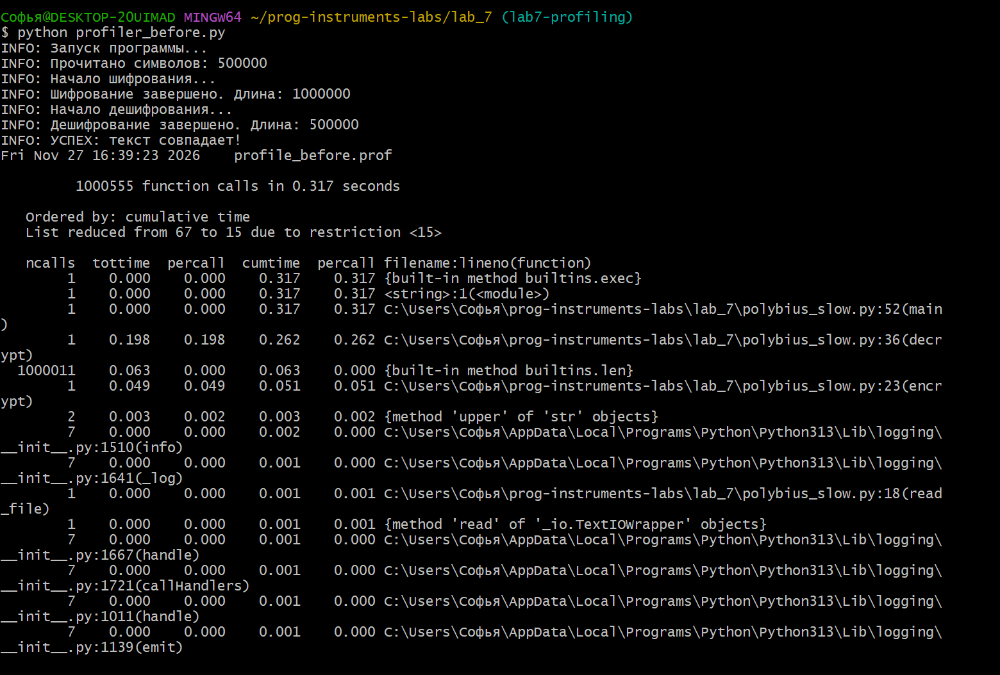
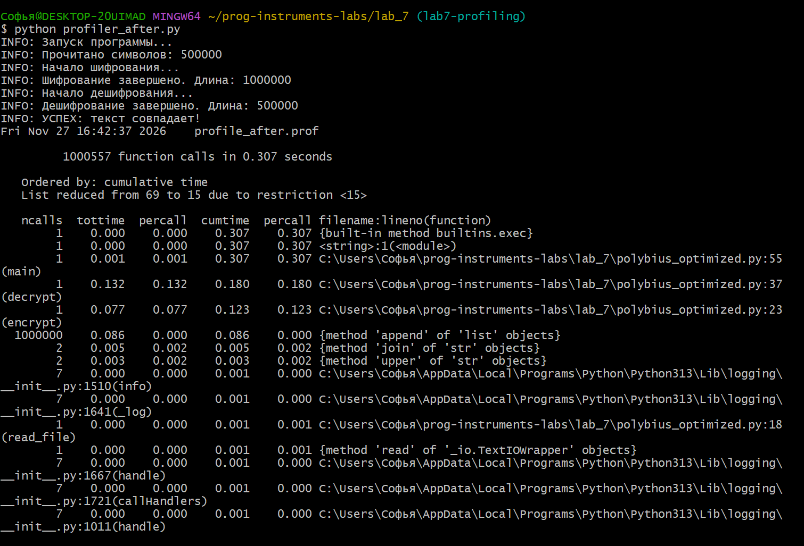
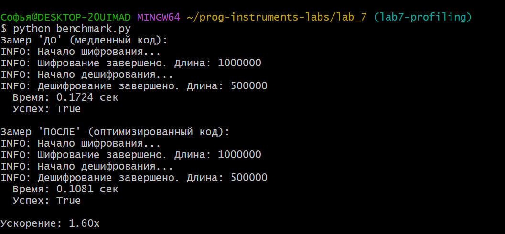

# Отчёт по лабораторной №7: профайлинг и оптимизация

## 1. С чего начала
Взяла свой код шифра Полибия. В функциях `encrypt` и `decrypt` строки собирались через `+=` в цикле, а в `decrypt` ещё и `len()` вызывался на каждой итерации `while`. На маленьких текстах это незаметно, но на больших такой код начинает тормозить.

## 2. Замер «до»
Запустила `cProfile` на файле примерно на 500 тысяч символов. Общее время — около **0.317 сек**. Основная нагрузка пришлась на `decrypt` — **0.262 сек**, то есть больше 80% всего времени. Функция `len` за один прогон вызывалась больше миллиона раз. Стало понятно, куда смотреть.

**Скриншот профилировщика (до оптимизации):**

## 3. Что поменяла
- В `encrypt` и `decrypt` вместо склейки строк через `+=` стала собирать куски в список, а в конце делать `''.join(...)`.
- В `decrypt` вынесла длину строки в переменную до цикла, чтобы не дёргать `len()` каждый раз.
- Там же убрала срезы `encrypted[i:i+2]`, заменив их на посимвольную проверку.

## 4. Замер «после»
Прогнала `cProfile` снова. Время `decrypt` упало до **0.180 сек** — примерно на 30% быстрее. Вызовов `len` теперь один вместо миллиона.

**Скриншот профилировщика (после оптимизации):**

Но `cProfile` сам по себе сильно искажает картину на коротких операциях, поэтому я дополнительно замерила время вручную через `time` (скрипт `benchmark.py`):
- было — **0.1724 сек**
- стало — **0.1081 сек**

**Скриншот ручного замера:**

Итоговое ускорение — примерно **в 1.6 раза**.

## 5. Вывод
Основной прирост дал отказ от конкатенации строк в цикле и кэширование длины. По `cProfile` `decrypt` ускорился на 30%, а по честному замеру вся программа стала работать примерно в полтора раза быстрее. Для кода, который раньше просто «склеивал строки», это ожидаемый и вполне ощутимый результат.
